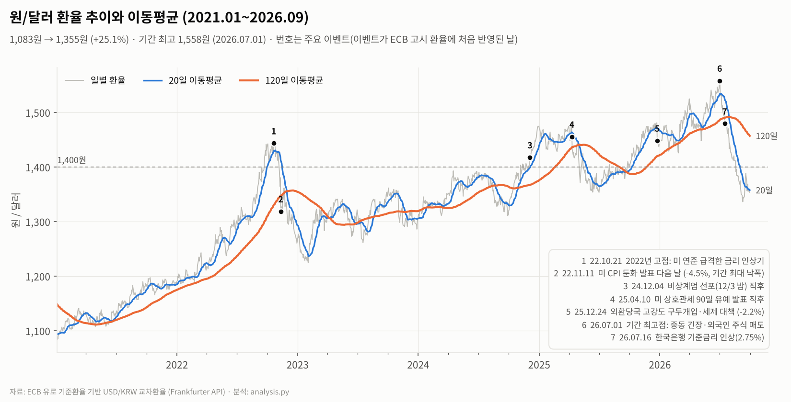
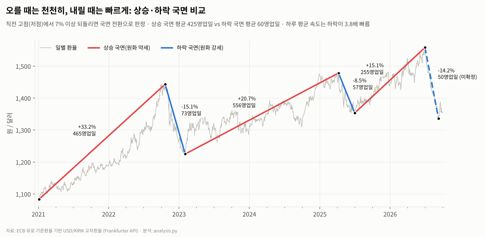
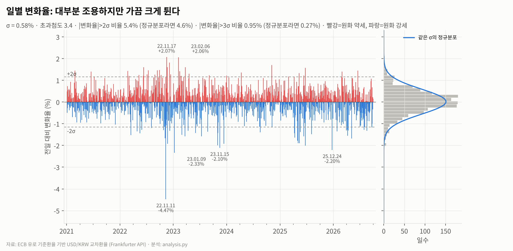
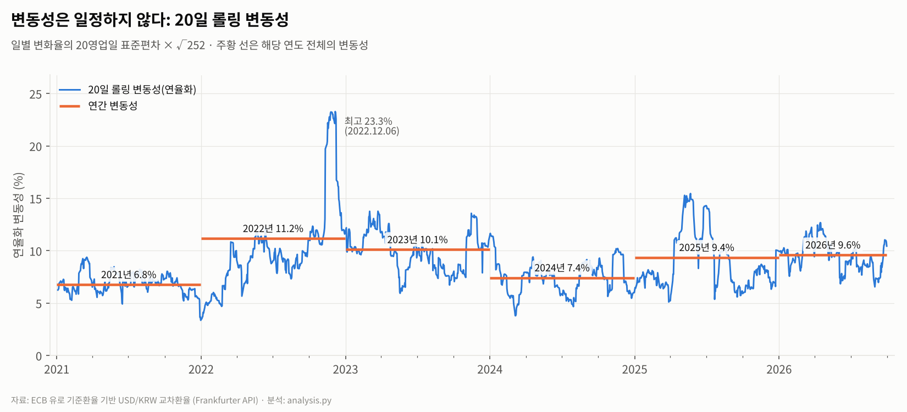
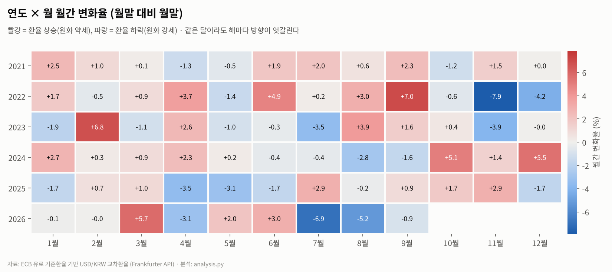
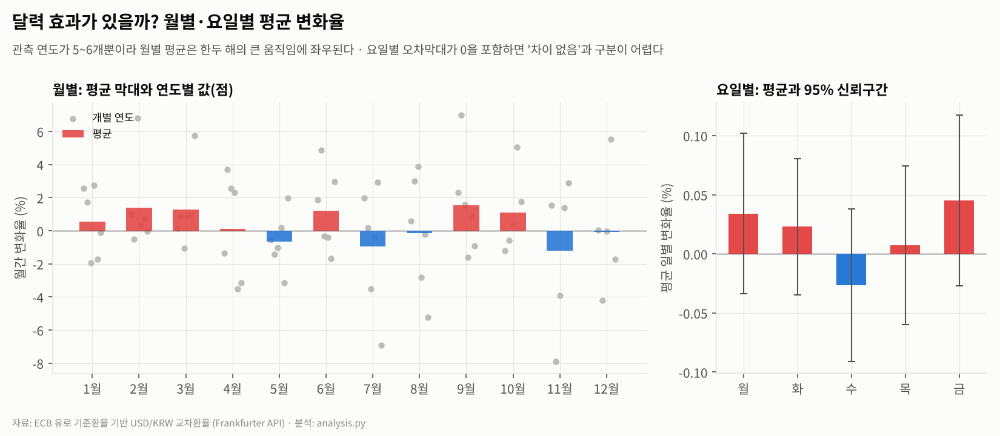
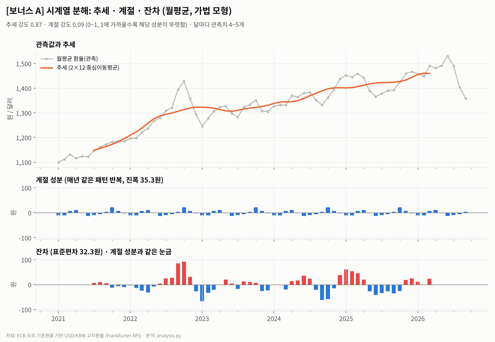
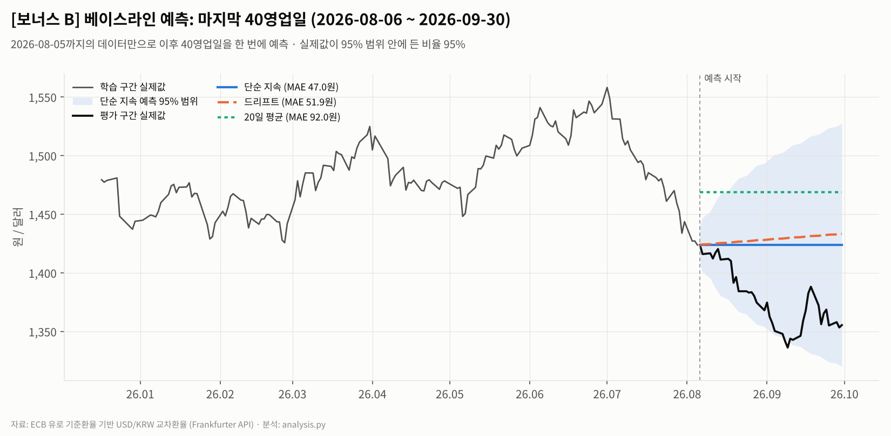

# 원/달러 환율 2021~2026년 트렌드 분석 리포트

> 분석 기간 2021-01-04 ~ 2026-09-30 · 일별 1,472개 데이터 포인트 · 분석 코드 `analysis.py`
>
> 모든 수치는 `outputs/` 폴더의 결과 파일(`summary.json`, `*.csv`)에서 그대로 옮겼다.

**한눈에 보기**

- 원/달러 환율은 5.75년 동안 **1,083원에서 1,355원으로 25.1% 올랐다**. 저점과 고점이 모두 계속 높아졌고, 1,400원 이상인 거래일 비중은 2021년 0%에서 2026년 84%가 됐다.
- 상승과 하락의 모양이 다르다. **오를 때는 평균 425영업일에 걸쳐 천천히, 내릴 때는 평균 60영업일 만에 빠르게** 움직였다. 하루 최대 변동 상위 10일 중 8일이 하락(원화 강세) 쪽이다.
- 큰 하루 움직임은 대부분 미국 물가·고용 지표나 FOMC 발표 직후와 날짜가 겹쳤다(인과관계는 가설). 반면 "몇 월에 환전하면 유리하다" 같은 월별·요일별 패턴은 데이터로 확인되지 않았다.

---

## 1. 분석 주제 및 선정 이유

- 원/달러 환율은 2022년에 잠시 1,400원을 넘었다가 내려왔고, 2024년 말 다시 넘은 뒤 2026년 7월 1,558원까지 올랐다. 이 때문에 "고환율이 새로운 표준(뉴노멀)이 됐다"는 이야기가 많았다. 그런데 2026년 7~9월에는 반대로 두 달 남짓 만에 14% 넘게 떨어졌다.
- 환율은 해외 직구, 여행, 유학비, 수출입 기업의 실적처럼 일상과 바로 연결된 숫자다.
- 이 리포트는 두 가지를 데이터로 확인하려 한다. 최근 몇 년의 오름세가 **추세인지 일시적 충격인지**, 그리고 **급변이 어떤 모양으로 오는지**다.

## 2. 분석 질문

| # | 질문 | 확인 방법 |
|---|---|---|
| Q1 | 2021~2026년 원/달러는 추세적으로 올랐는가? 1,400원은 여전히 '예외적인 고점'인가? | 이동평균, 연도별 통계, 1,400원 이상 거래일 비중 (그래프로 확인) |
| Q2 | 오를 때와 내릴 때의 속도·기간이 같은가? | 상승/하락 국면 구분(지그재그), 변화율 분포 (추가 해석 필요) |
| Q3 | 하루 급등락은 언제 있었고, 어떤 외부 이벤트와 연결해 볼 수 있는가? | 일별 변화율 상위 10일, 뉴스 대조 (추가 해석 필요) |
| Q4 | 변동성은 시기별로 어떻게 달랐는가? 원화 약세기와 강세기 중 언제 더 컸는가? | 20일 롤링 변동성, 연도별 변동성 (그래프 + 해석) |
| Q5 | 월별·요일별로 반복되는 패턴(계절성)이 있는가? | 월별·요일별 집계, 시계열 분해 (그래프 + 통계) |
| 보너스 | 과거 데이터만으로 단기 환율을 예측할 수 있는가? | 베이스라인 예측과 오차 비교 |

## 3. 데이터 설명

| 항목 | 내용 |
|---|---|
| 출처 | 유럽중앙은행(ECB) 유로 기준환율을 [Frankfurter API](https://frankfurter.dev)로 받아 USD 기준으로 다시 계산한 **USD/KRW 교차환율** |
| 값의 의미 | 1달러당 원화. 값이 오르면 원화 약세, 내리면 원화 강세 |
| 집계 시점 | ECB가 매 영업일 **14:10 CET경** 집계하고 16:00경 공표한다([ECB](https://www.ecb.europa.eu/stats/eurofxref)). 한국 시간으로 21:10(여름)~22:10(겨울)이다 |
| 분석 기간 | 2021-01-04 ~ 2026-09-30. 마지막으로 끝난 달까지 잘라 월간 집계가 왜곡되지 않게 했다 |
| 데이터 수 | 분석 기간 **1,472영업일**. 2021년 초부터 120일 이동평균을 계산하려고 2020-07-01부터 수집했다(총 1,603행) |
| 컬럼 | `date`(날짜), `usd_krw`(환율) |
| 수집 방법 | `python download_data.py`. 연도별로 API를 호출하고, 원본 응답은 `data/raw/`에 보관한다 |
| 라이선스 | [ECB 통계 재사용 정책](https://www.ecb.europa.eu/stats/ecb_statistics/governance_and_quality_framework/html/usage_policy.en.html)에 따라 무료로 재사용할 수 있고, 출처 표기(예: "Source: ECB statistics")가 필요하다. 이 데이터는 ECB의 유로 기준환율로 Frankfurter가 계산한 교차환율(파생값)이다. ECB는 기준환율을 정보 제공용으로 공개하며, 거래 목적 사용은 권장하지 않는다 |

### 3.1 FRED가 아닌 ECB 데이터를 쓴 이유와 교차 검증

원래는 미국 연준 FRED의 원/달러 시리즈(DEXKOUS)를 쓰려 했다. 그런데 작업일(2026-10-22)에 FRED CSV 다운로드가 점검 화면만 돌려줘서 ECB 기준환율로 바꿨다. ECB 값은 서울 외환시장 종가가 아니라 유럽 오후 시점의 스냅샷이다. 그래서 언론에 보도된 서울 시장 환율과 직접 대조해 봤다.

| 날짜 | 보도된 서울 시장 환율 | ECB 기반 값 | 차이 |
|---|---|---|---|
| 2025-12-24 | 1,449.8 (종가, [뉴시스](https://mobile.newsis.com/view/NISX20251224_0003454199)) | 1,448.24 | −0.11% |
| 2026-06-04 | 1,529.7 (종가, [뉴시스](https://www.newsis.com/view/NISX20260604_0003656997)) | 1,532.52 | +0.18% |
| 2026-06-30 | 1,549.4 ([Korea Times](https://koreatimes.co.kr/economy/20260802/improved-dollar-supply-fuels-wons-strongest-monthly-gain-since-2009)) | 1,550.89 | +0.10% |
| 2026-07-01 | 1,559.2 (같은 기사) | 1,558.09 | −0.07% |
| 2026-07-31 | 1,424.0 (같은 기사) | 1,443.61 | +1.38% |

다섯 날 중 네 날은 차이가 ±0.2% 안이었다. 2026-07-31만 1.4% 차이가 났는데, 하루 중 환율이 크게 움직인 날에는 집계 시점 차이가 그대로 드러나기 때문으로 본다. **결론: 추세·국면·변동성 분석에는 충분히 쓸 수 있다. 다만 특정 날짜의 '정확한 서울 종가'가 필요하면 한국은행 ECOS 데이터로 확인해야 한다.**

> **시점 차이 주의.** 미국 경제지표(08:30 ET ≈ 14:30 CET)와 FOMC 결정(14:00 ET)은 ECB 집계(14:10 CET) **뒤에** 나온다. 그래서 미국발 뉴스는 이 데이터에서 **다음 영업일**에 나타난다. 예외로, 미국과 유럽의 서머타임 전환일이 어긋나는 3월·10~11월의 몇 주는 미국 지표가 13:30 CET에 나와 당일 값에 반영된다. 상위 10일 중 이 예외에 해당하는 경우는 없다(2023-11-02는 이 기간이지만 관련 이벤트가 FOMC라 시점 차이와 무관하다). 2024-12-03 밤 비상계엄 선포(22:27 KST = 14:27 CET)도 12월 4일 값에 처음 반영됐다.

### 3.2 데이터 정제: 결측치와 이상치

| 점검 항목 | 결과 |
|---|---|
| 날짜 파싱 실패 / 중복 날짜 | 0 / 0 |
| 값이 비어 있음(NaN) / 0 이하 | 0 / 0 |
| 주말 데이터 | 0 |
| 평일인데 값이 없는 날 | **27일**, 모두 ECB 휴무일(1/1, 성금요일, 부활절 월요일, 5/1, 12/25, 12/26) |

**결측치 처리 기준.** 27일은 기준환율이 아예 고시되지 않은 '거래 없는 날'이라 **채우지 않고 제외**했다. 앞 날짜 값으로 채우면 변화율이 0%인 가짜 거래일이 생겨 변동성이 실제보다 작게 계산되기 때문이다. 그 결과 휴무일 다음 날의 변화율에는 휴무일을 건너뛴 기간 전체의 변화가 담긴다(예: 부활절 연휴는 목요일→화요일).

**이상치 처리 기준.**

1. **후보 찾기.** 일별 변화율의 로버스트 z-score(중앙값과 MAD×1.4826 = 0.48% 사용)가 절대값 5를 넘는 날을 후보로 잡았다. 평균·표준편차는 큰 값 자체에 끌려가므로 중앙값 기반 기준을 썼다.
2. **데이터 오류인지 판정.** 후보가 둘 중 하나에 해당하면 오류로 의심하기로 했다.
   - 튄 다음 날 80% 이상 되돌아감(spike-and-revert)
   - 전후 21영업일 중앙값과 5% 넘게 벌어짐
3. **결과.** 후보는 1건이었다. 2022-11-11, −4.47%, z = −9.4다. 다음 날 변화는 +0.64%로 되돌림이 아니었고, 중앙값과의 괴리도 3.19%로 기준 미만이었다. 같은 날 서울 시장에서도 하루 59.1원이 떨어졌다는 보도가 있다([뉴시스](https://mobile.newsis.com/view/NISX20251224_0003454199)). → **실제 시장 움직임으로 판단해 유지했다.** 금융 데이터에서 큰 변동은 지울 오류가 아니라 분석해야 할 대상이다.

## 4. 분석 방법

**시계열의 세 가지 구성요소.** 이 리포트는 환율의 움직임을 세 성분으로 나눠 본다.

- **추세(trend):** 몇 달~몇 년에 걸친 큰 방향. 이동평균과 선형 추세로 확인한다.
- **계절성(seasonality):** 매년 같은 달, 매주 같은 요일처럼 달력을 따라 반복되는 패턴. 월별·요일별 집계와 시계열 분해로 확인한다.
- **노이즈(잔차):** 추세와 계절성으로 설명되지 않는 나머지 불규칙한 움직임. 일별 변화율의 분포와 분해의 잔차로 크기를 잰다.

| 기법 | 계산 방식 | 왜 썼나 |
|---|---|---|
| 이동평균 | 20 / 60 / 120 영업일(약 1개월 / 분기 / 반년) | 일별 노이즈를 걷어내고 추세의 방향을 보기 위해. 20일선과 120일선의 교차로 방향 전환 시점을 확인 |
| 일별 변화율 | (오늘 / 전 영업일 − 1) × 100 | 환율 수준이 다른 시기끼리 비교할 수 있고, 급등락을 찾기 쉬움 |
| 롤링 변동성 | 일별 변화율의 20영업일 표준편차 × √252 | 시기별로 위험(흔들림)의 크기가 얼마나 달랐는지 비교 |
| 구간별 통계 | 연도별 시작·끝·평균·최고·최저·변동성 | 해마다의 성격을 같은 기준으로 비교 |
| 상승/하락 국면 구분 | 직전 고점(저점)에서 **7% 이상** 되돌리면 국면 전환(지그재그) | 일상적인 등락이 아닌 '큰 흐름' 단위로 기간과 속도를 비교. 7%는 연간 변동성(약 9%)보다 조금 작은 수준이고, 6~8% 어느 값을 써도 같은 국면이 나왔다 |
| 월별·요일별 집계 | 월말 대비 월말 변화율, 요일별 평균 일별 변화율과 95% 신뢰구간 | 달력 효과(계절성)가 있는지 확인 |
| [보너스] 시계열 분해 | 월평균에 2×12 중심이동평균(추세) + 월별 평균 편차(계절) + 잔차 | 추세와 계절성을 나눠 각각의 크기를 비교 |
| [보너스] 베이스라인 예측 | 단순 지속, 드리프트, 20일 평균 | 복잡한 모델 전에 넘어야 할 '기준선'을 확인 |

**집계 단위 선택 이유.** 급등락과 변동성은 하루 단위에서만 보여서 **일 단위**로 분석했다. 계절성과 분해는 일별 노이즈가 패턴을 가리기 때문에 **월 단위**로 바꿨다. 해마다의 성격을 비교할 때는 **연 단위**를 썼다.

**축과 스케일 점검.** 날짜는 오름차순으로 정렬했고, 휴무일은 값을 채우지 않아 그래프에서 앞뒤 거래일이 바로 이어진다. 환율 수준 그래프(01, 02)는 y축을 0이 아니라 1,100원 근처에서 시작했다. 0부터 그리면 5년간 25%의 변화가 평평하게 보이기 때문이다. 대신 변화가 실제보다 커 보일 수 있어서, 같은 흐름을 비율(일별 변화율, 03)로도 함께 보여 준다.

## 5. 분석 결과 및 시각화

### 5.1 전체 추세 (Q1)



| 연도 | 시작 | 끝 | 평균 | 최고(날짜) | 연간 변동성 | 1,400원 이상 일수 비중 | 전년 말 대비 |
|---|---|---|---|---|---|---|---|
| 2021 | 1,083.30 | 1,188.75 | 1,145.51 | 1,197.23 (10-12) | 6.77% | 0.0% | +9.18% |
| 2022 | 1,192.78 | 1,260.16 | 1,292.98 | 1,443.29 (10-21) | 11.17% | 12.5% | +6.01% |
| 2023 | 1,270.99 | 1,297.43 | 1,306.85 | 1,361.46 (10-03) | 10.11% | 0.0% | +2.96% |
| 2024 | 1,313.23 | 1,474.78 | 1,363.53 | 1,474.78 (12-31) | 7.42% | 9.8% | +13.67% |
| 2025 | 1,467.95 | 1,444.20 | 1,421.52 | 1,480.88 (12-23) | 9.36% | 60.8% | −2.07% |
| 2026 (~9월) | 1,444.87 | 1,355.40 | 1,461.31 | 1,558.09 (07-01) | 9.60% | 83.8% | −6.15% |

**관찰**

- 기간 전체 상승률은 +25.1%다. 선형 추세 기울기는 **연 +59.8원**(R² = 0.80)이다.
- 연평균 환율은 6년 내내 해마다 올랐다(1,146 → 1,293 → 1,307 → 1,364 → 1,422 → 1,461원, 2026년은 1~9월 평균).
- 1,400원 이상인 거래일 비중은 2021년 0%, 2024년 9.8%, 2025년 60.8%, 2026년 83.8%로 늘었다.
- 20일선과 120일선은 기간 중 12번 교차했다. 가장 최근은 2026-07-30 하향 돌파다.

### 5.2 상승·하락 국면의 비대칭 (Q2)



| 국면 | 기간 | 변화 | 영업일 | 하루 평균 |
|---|---|---|---|---|
| 상승 | 2021-01-04 → 2022-10-21 | 1,083 → 1,443 (+33.2%) | 465 | +0.071% |
| 하락 | 2022-10-21 → 2023-02-02 | 1,443 → 1,225 (−15.1%) | 73 | −0.207% |
| 상승 | 2023-02-02 → 2025-04-08 | 1,225 → 1,478 (+20.7%) | 556 | +0.037% |
| 하락 | 2025-04-08 → 2025-07-01 | 1,478 → 1,353 (−8.5%) | 57 | −0.148% |
| 상승 | 2025-07-01 → 2026-07-01 | 1,353 → 1,558 (+15.1%) | 255 | +0.059% |
| 하락 | 2026-07-01 → 2026-09-09 | 1,558 → 1,336 (−14.2%) | 50 | −0.285% (미확정) |

**관찰**

- 상승 국면은 평균 **425영업일**, 하락 국면은 평균 **60영업일**이었다. 하루 평균 속도는 하락이 **3.8배** 빨랐다.
- 상승이 시작된 저점(1,083 → 1,225 → 1,353원)과 고점(1,443 → 1,478 → 1,558원)이 모두 계속 높아졌다.
- **민감도 점검.** 기준을 5%로 낮추면 국면이 상승·하락 각 7개로 잘게 나뉜다. 그래도 평균 기간은 상승 146영업일, 하락 62영업일로 '하락이 짧다'는 결과는 유지됐다. 10%로 높이면 속도 차이는 4.8배였다.
- 마지막 하락 국면은 아직 7% 반등이 없어 저점이 확정되지 않았다(9월 말 1,355원).

### 5.3 하루 급등락 (Q3)



**관찰**

- 일별 변화율의 표준편차는 0.58%다. 분포가 정규분포보다 꼬리가 두껍다(초과첨도 3.4).
  - ±2σ 밖의 날: 5.4% (정규분포라면 4.6%)
  - ±3σ 밖의 날: **0.95%** (정규분포라면 0.27%, 약 3.5배)
- 상승한 날이 52.1%로 조금 더 많다. 평균 상승폭(+0.43%)과 평균 하락폭(−0.43%)은 거의 같다. 그런데 분포는 왼쪽으로 기울어 있다(왜도 −0.57). 아주 큰 움직임이 하락 쪽에 몰려 있다는 뜻이다.

**일별 변화율 상위 10일과 가능한 관련 이벤트**

이벤트 열은 날짜가 가까운 사건을 짝지은 **가설**이며, 인과관계를 증명한 것은 아니다. ECB 집계 시점 때문에 미국발 뉴스는 다음 영업일에 나타난다.

| 날짜(요일) | 변화율 | 가능한 관련 이벤트 (가설) |
|---|---|---|
| 2022-11-11 (금) | −4.47% | 전날 미국 10월 소비자물가(CPI) 둔화 발표. 서울 시장에서도 하루 59.1원 하락 |
| 2023-01-09 (월) | −2.33% | 직전 금요일 미국 고용지표(임금 상승 둔화)·서비스업 지표 부진 |
| 2025-12-24 (수) | −2.20% | 외환당국 공동 구두개입과 해외주식 매도·국내 복귀 시 양도세 감면 등 대책([뉴시스](https://mobile.newsis.com/view/NISX20251224_0003454199)) |
| 2023-11-15 (수) | −2.10% | 전날 미국 10월 CPI 둔화 발표 |
| 2022-11-17 (목) | +2.07% | **원인 미확인** (11-11 급락 이후 되돌림 구간) |
| 2023-02-06 (월) | +2.06% | 직전 금요일 미국 1월 고용 '서프라이즈' |
| 2025-06-24 (화) | −2.02% | 이스라엘·이란 휴전 발표 직후 위험선호 회복 |
| 2023-11-02 (목) | −2.00% | 전날 FOMC 금리 동결 |
| 2022-11-24 (목) | −1.92% | 전날 FOMC 의사록 공개(금리 인상 속도 조절 시사) |
| 2023-12-14 (목) | −1.92% | 전날 FOMC에서 이듬해 금리 인하 전망 제시 |

### 5.4 변동성 (Q4)



**관찰**

- 20일 변동성은 최저 3.4%(2021-12-31)에서 최고 **23.3%(2022-12-06)**까지 약 7배 차이가 났다.
- 연간 변동성은 2021년이 6.8%로 가장 낮았다. 2022년이 11.2%로 가장 높았고, 2025·2026년은 9.4~9.6%였다.
- 최고점(2022-12)은 환율이 가장 높았던 때가 아니다. 2022년 11월 급락 **직후**였다.
- 기간 중 두 번째로 높은 봉우리(15.5%, 2025-05-22)도 2025년 4~7월 하락 국면 안에 있다.
- 20일 변화율과 20일 변동성의 상관계수는 **−0.31**이다. 즉 원화가 강해지는 구간에서 변동성이 더 컸다(원화 강세 구간 평균 9.5% vs 약세 구간 8.3%).
- 다만 2022-10-15~2023-01-31 구간을 빼면 상관계수가 −0.11로 약해진다(9.5% vs 8.3% → 8.8% vs 8.2%).
- 환율 **수준**과 변동성의 상관계수는 0.21로 약했다.

**해석:** '원화 강세 구간에 변동성이 더 크다'는 결과는 2022년 말 한 구간에 크게 기대고 있어, 일반적인 경향이라고 단정하기는 어렵다.

### 5.5 달력 효과 (Q5)





**관찰**

- 같은 달이라도 해마다 방향이 엇갈린다. 11월은 2022년 −7.9%, 2025년 +2.9%였다. 11월은 평균(−1.20%)과 중앙값(+1.39%)의 부호마저 반대다.
- 월별 평균이 가장 높은 달은 9월(+1.54%)이다. 3월은 6년 중 5년 올랐다. 달마다 관측치는 5~6개뿐이다.
- 요일별 평균 일별 변화율은 −0.026%(수)~+0.045%(금)였다. **다섯 요일 모두 95% 신뢰구간이 0을 포함한다**(|t| ≤ 1.23).

**해석:** 동전을 6번 던져 5번 이상 앞면이 나올 확률이 약 11%다. 그러니 12개월 중 한두 달이 '잘 오르는 달'처럼 보이는 것은 우연으로도 충분히 설명된다. 요일 효과도 통계적으로 0과 구분되지 않는다.

### 5.6 [보너스 A] 시계열 분해



**관찰**

- 추세 강도는 **0.87**, 계절 강도는 **0.09**다. 0에 가까울수록 해당 성분이 잔차와 구분되지 않는다는 뜻이다.
- 계절 성분의 진폭(가장 높은 달과 가장 낮은 달의 차이)은 35원이다(10월 +22원, 6월 −13원). 같은 기간 추세가 움직인 폭은 312원이었고, 잔차의 표준편차가 32원이었다.
- 2×12 중심이동평균은 앞뒤 6개월씩이 필요하다. 그래서 추세는 2021년 7월~2026년 3월 구간만 계산됐다. 달마다 계절지수를 만든 관측치는 4~5개다.

**해석:** 분해가 찾아낸 '계절 패턴'은 잔차(노이즈)와 크기가 비슷해서, 실제로 반복되는 패턴인지 우연히 생긴 모양인지 구분하기 어렵다. 이 기간 환율의 움직임은 대부분 추세로 설명된다.

### 5.7 [보너스 B] 베이스라인 예측



| 방법 | 가정 | 40영업일 한 번에 예측 MAE | MAPE | 매일 다시 1일 앞 예측 MAE (최근 250일) |
|---|---|---|---|---|
| 단순 지속 | 앞으로도 마지막 값(1,423.72원)과 같다 | **46.97원** | 3.45% | **6.74원** |
| 드리프트 | 과거 평균 기울기가 계속된다 | 51.85원 | 3.80% | 6.74원 |
| 20일 평균 | 최근 20일 평균으로 돌아간다 | 91.99원 | 6.72% | 20.16원 |
| 5일 평균 | 최근 5일 평균으로 돌아간다 | — | — | 10.27원 |

**관찰**

- 학습은 2026-08-05까지, 평가는 2026-08-06~09-30(40영업일)이다. 세 방법 모두 이 기간의 하락을 맞히지 못했다.
- 그래도 가장 단순한 '단순 지속'의 오차가 가장 작았다. 매일 다시 예측하는 방식에서도 단순 지속(6.74원)이 이동평균 방식(10.27원, 20.16원)보다 나았다.
- 일별 변화율의 자기상관은 10개 시차 중 7개가 95% 경계(±0.051) 안에 있다. 경계를 넘은 세 개(시차 1: −0.052, 시차 3: −0.053, 시차 6: −0.084)도 경계 근처의 작은 값이다.
- 단순 지속 예측의 95% 범위는 40영업일 뒤 **±104원**까지 넓어진다. 실제값은 40일 중 38일(95%)이 범위 안에 있었다.

**해석:** 자기상관이 거의 0이라는 것은 오늘의 움직임으로 내일을 거의 알 수 없다는 뜻이다. 그래서 과거 값을 평균 내는 방법이 '어제와 같다'보다 나을 이유가 없다.

**예측의 가정과 한계**

| 대상 | 가정 | 한계 |
|---|---|---|
| 단순 지속 | 환율이 랜덤워크다. 내일 변화의 기댓값은 0이다 | 추세나 큰 이벤트가 있어도 반영하지 못한다 |
| 드리프트 | 학습 기간의 평균 기울기(하루 +0.238원)가 앞으로도 이어진다 | 추세가 꺾이는 시기에는 오차가 커진다. 이번 평가 구간이 그런 경우다 |
| 20일 평균 | 환율이 최근 평균으로 돌아간다(평균 회귀) | 추세가 있는 시기에는 항상 한발 늦는다 |
| 95% 범위 | 일별 변화가 서로 독립이고 정규분포를 따르며, 변동성이 최근 1년 수준(하루 8.37원)으로 일정하다 | 실제 분포는 꼬리가 두꺼워(±3σ 밖의 날이 정규분포의 3.5배) 큰 충격이 오면 범위를 벗어날 수 있다 |
| 평가 방식 | 40영업일 한 구간으로 비교한다 | 평가 구간이 마침 급락기였다. 다른 구간에서는 방법 간 순위가 달라질 수 있어 롤링 1일 앞 평가로 보완했다 |
| 입력 정보 | 과거 환율만 쓴다 | 금리·뉴스 같은 외부 정보가 없어서, 이벤트로 생기는 큰 움직임은 원리적으로 예측할 수 없다 |

## 6. 인사이트

### 인사이트 1. 1,400원은 '천장'에서 '바닥'에 가까운 자리로 옮겨 갔다

- **관찰(Fact)**
  - 1,400원 이상인 거래일 비중이 2021년 0% → 2025년 60.8% → 2026년 83.8%로 늘었다.
  - 상승 국면의 저점(1,083 → 1,225 → 1,353원)과 고점(1,443 → 1,478 → 1,558원)이 모두 계속 높아졌다.
  - 연평균은 6년 연속 상승했고, 선형 추세는 연 +59.8원이다.
- **원인(Why, 가설)**
  1. 미국의 고금리와 내국인의 해외투자 확대처럼, 원화를 달러로 바꾸려는 구조적 수요가 꾸준히 쌓였다.
  2. 2026년 상반기 1,500원대 진입 때는 미국·이란 군사 충돌에 따른 유가 상승, 외국인의 국내 주식 순매도(19거래일 연속, 누적 66조원 이상), 관세 불확실성이 함께 거론됐다([뉴시스](https://www.newsis.com/view/NISX20260604_0003656997)).
  - **반례:** 2026년 7~9월에 두 달 남짓 만에 −14.2%가 빠졌다. 9월 말 1,355원은 2025년 7월 저점(1,353원)과 비슷하다. '구조적 상승'이 생각보다 빨리 되돌려질 수 있다는 뜻이다.
- **행동(Action)**
  - "1,400원 = 예외적 고점"이라는 기준을 그대로 쓰지 말고, 최근 2~3년 분포(예: 120일 이동평균 대비 위치)로 판단한다.
  - 추가 분석으로 한미 금리차, 내국인 해외증권투자, 외국인 주식 순매수 데이터를 붙여 원인 가설을 검증한다.

### 인사이트 2. 계단처럼 오르고 엘리베이터처럼 내린다

- **관찰(Fact)**
  - 국면별 평균 기간은 상승 **425영업일**, 하락 **60영업일**이고, 하루 평균 속도는 하락이 **3.8배** 빠르다.
  - 하루 변화율 상위 10일 중 **8일이 하락(원화 강세)** 쪽이고, 분포의 왜도는 −0.57이다.
  - 원화 강세 구간의 평균 변동성(9.5%)이 약세 구간(8.3%)보다 조금 높다. 단, 2022년 말 한 구간을 빼면 차이가 작아진다(8.8% vs 8.2%).
- **원인(Why, 가설)**
  1. 원화 약세는 해외투자·금리차 같은 꾸준한 수요가 조금씩 쌓여서 진행되고, 원화 강세는 큰 이벤트로 한꺼번에 일어난다. 이벤트의 예로는 미국 물가 둔화, 당국 개입, 대형 달러 유입이 있다. 2026년 7월에는 SK하이닉스 ADR 상장(7/10) 자금의 원화 환전, 수출기업의 달러 매도, 한국은행 기준금리 인상(7/16, 2.75%)이 꼽혔다([Korea Times](https://koreatimes.co.kr/economy/20260802/improved-dollar-supply-fuels-wons-strongest-monthly-gain-since-2009), [KB Think](https://kbthink.com/investment/fx/monthly/260831-4.html)).
  2. 환율이 오를 때 당국의 속도 조절(스무딩)이 상승 속도를 늦췄을 수 있다(이 데이터로는 검증 불가).
- **행동(Action)**
  - 달러가 필요한 개인·기업이라면 '하락 국면은 짧게 지나간다'는 점을 고려해, 하락이 시작되면 미루기보다 목표 구간을 정해 분할 환전한다.
  - 다음 분석으로 하락 국면의 시작을 빨리 알아챌 수 있는 신호를 비교해 본다(예: 20일선의 120일선 하향 돌파, 변동성 급등).

### 인사이트 3. 큰 하루 움직임은 '미국발 뉴스 다음 날'에 몰린다

- **관찰(Fact)**
  - 상위 10일 중 **7일**이 미국 CPI·고용지표·FOMC(결정·의사록) 발표 다음 첫 고시일과 **날짜가 겹친다**.
  - 나머지 3일 중 1일은 국내 외환당국 구두개입일, 1일은 이스라엘·이란 휴전 발표 다음 날과 겹치고, 1일은 겹치는 사건을 찾지 못했다.
  - 월요일 2건(2023-01-09, 2023-02-06)은 모두 직전 금요일의 미국 고용지표 발표와 겹친다.
  - 기간 최대 낙폭(2022-11-11, −4.47%)은 유일하게 이상치 기준(z = −9.4)을 넘었다.
- **원인(Why, 가설)**
  - 날짜가 겹친 사건이 실제 원인이라면, 원/달러의 단기 움직임은 국내 요인보다 **미국 통화정책 기대 → 글로벌 달러 방향**에 더 크게 좌우된다고 볼 수 있다.
  - 다만 이 짝짓기는 날짜가 가깝다는 것에 근거한 사후 해석이다. 같은 이벤트가 있었는데 크게 움직이지 않은 날은 세지 않았다(선택 편향 가능).
- **행동(Action)**
  - 미국 경제지표 일정 데이터를 붙여 '발표 다음 날'과 '일반일'의 평균 |변화율|을 비교하는 통제된 분석을 한다.
  - 환전·결제 일정이 있다면 미국 CPI·FOMC 발표 직후를 변동 위험이 큰 날로 표시해 둔다.

### 인사이트 4. "○월에 환전하면 유리하다"는 근거가 없다

- **관찰(Fact)**
  - 계절 강도는 0.09로, 추세 강도 0.87과 큰 차이가 난다.
  - 계절 진폭은 35원으로, 잔차 표준편차(32원)와 비슷하고 추세 이동폭(312원)의 약 1/9이다.
  - 같은 11월이 2022년 −7.9%, 2025년 +2.9%였다.
  - 요일별 평균은 모두 95% 신뢰구간이 0을 포함한다.
- **원인(Why, 가설)**
  - 환율은 상품 판매량처럼 달력에 묶인 수요가 아니라, 금리·자금흐름·뉴스로 움직이는 자산 가격이다.
  - 연말 배당금 송금이나 분기말 수출대금처럼 계절적 요인이 있더라도, 더 큰 요인에 묻히는 것으로 보인다.
- **행동(Action)**
  - 특정 달·요일을 기준으로 환전 시점을 정하지 않는다.
  - 계절성을 제대로 검증하려면 20년 이상 데이터로 다시 분석한다. 6년(월별 관측치 4~6개)으로는 결론을 낼 수 없다.

### 인사이트 5 (보너스). 가장 좋은 예측은 '어제와 같다'이고, 중요한 것은 범위다

- **관찰(Fact)**
  - 1일 앞 예측 오차는 단순 지속 6.74원, 5일 평균 10.27원, 20일 평균 20.16원이었다.
  - 40영업일 예측에서도 단순 지속의 MAE가 46.97원으로 가장 작았다.
  - 일별 변화율의 자기상관은 대부분 0에 가깝다.
  - 단순 지속의 95% 범위는 40일 뒤 ±104원이었고, 실제값의 95%가 그 안에 들었다.
- **원인(Why, 가설)**
  - 환율이 랜덤워크에 가깝다는 것, 즉 공개된 정보가 이미 가격에 반영돼 있어 과거 움직임만으로는 다음 방향을 알기 어렵다는 것과 맞는 결과다.
- **행동(Action)**
  - 환율이 필요한 계획(예산·견적)은 점 예측 대신 '현재값 ± 변동성 범위' 시나리오로 세운다. 예를 들어 2개월 뒤라면 ±100원 안팎이다.
  - 더 복잡한 모델을 시도한다면, 이 베이스라인보다 좋은지를 반드시 롤링 방식으로 비교한다.

## 7. 결론 및 한계점

### 결론

- **Q1.** 2021~2026년 원/달러는 뚜렷한 상승 추세였다(+25.1%, 연 +59.8원, 추세 강도 0.87). 1,400원은 더 이상 예외적인 고점이 아니다. 다만 2026년 7~9월 급락으로 추세가 꺾였는지는 아직 판단하기 이르다.
- **Q2.** 상승은 길고 느리게(평균 425영업일), 하락은 짧고 빠르게(평균 60영업일, 속도 3.8배) 진행됐다.
- **Q3.** 하루 큰 움직임은 대부분 원화 강세 쪽이었고, 미국 지표·FOMC 발표 직후에 몰렸다(가설 수준).
- **Q4.** 변동성은 2022년이 가장 컸고, 최고점은 급락 직후였다. 원화 강세 구간의 변동성이 조금 높았지만 한 구간의 영향이 크다.
- **Q5.** 월별·요일별 패턴은 통계적으로 확인되지 않았다.
- **보너스.** 과거 값만으로 하는 예측은 '어제와 같다'를 넘지 못했다.

### 한계점

- **데이터 시점.** ECB 기준환율은 하루 한 번 유럽 오후에 찍은 스냅샷이다. 서울 종가와는 대부분 ±0.2% 안에서 맞았지만, 많이 움직인 날에는 1% 넘게 다를 수 있다.
- **외부 변수 미반영.** 금리차, 수출, 외국인 자금흐름 같은 원인 변수는 넣지 않았다. 인사이트의 '원인'은 모두 검증 전 가설이다.
- **짧은 기간.** 5.75년으로는 국면이 6개, 연도가 6개, 달별 관측치가 4~6개뿐이라 일반화에 한계가 있다.
- **임계값 선택.** 국면 구분은 7% 기준에 따라 달라진다. 민감도 점검(5~10%)에서 방향은 유지됐지만 크기는 1.3~4.8배로 달라졌다.
- **분해의 가정.** 고전적 가법 분해는 계절 패턴이 매년 같다고 가정한다. 양 끝 6개월은 추세를 계산하지 못한다.
- **예측 평가.** 40일 평가 구간이 하필 급락기여서 결과가 그 구간에 좌우된다. 롤링 1일 앞 평가로 보완했다.
- **이벤트 매칭.** 큰 움직임이 있던 날에서 출발해 사건을 찾았기 때문에 사후 해석과 선택 편향이 섞여 있다. 출처를 달지 않은 미국 지표·FOMC 날짜는 널리 알려진 일정이지만, 다시 확인하는 것이 좋다.

## 8. AI 사용 로그

| 사용 작업 | 사용 이유 | 검증 방법 |
|---|---|---|
| 데이터 출처 탐색·수집 스크립트 작성 (FRED 점검으로 ECB 기준환율 API로 대체) | 대안 탐색, 시간 절감 | 연도별 수신 건수(연 255~258영업일) 확인. 언론에 보도된 서울 시장 환율 5개 날짜와 대조(3.1절 표) |
| 결측치·이상치 기준 설계와 코드 | 처리 기준 대안 비교 | 누락 27일을 ECB 휴무일 달력과 하나씩 대조(27/27 일치). 이상치 1건은 같은 날 서울 시장 보도로 교차 확인 |
| 지표 계산·시각화 코드 (pandas, matplotlib) | 시간 절감 | 합성 데이터로 먼저 실행해 오류 확인. 실제 데이터로 두 번 실행해 `summary.json` 수치가 같은지 비교. 그래프를 직접 열어 라벨 겹침·축 범위 수정 |
| 시계열 분해·베이스라인 예측 구현 (statsmodels 없이 직접 구현) | 설치 제약 우회, 계산 원리 이해 | 2×12 가중치 합 = 1, 12개월 계절지수 합 ≈ 0 확인. 단순 지속 MAE(46.973원)와 2022-11-11·2025-12-24 변화율을 별도 코드로 다시 계산해 일치 확인 |
| 급등락 날짜와 외부 이벤트 조사 (웹 검색) | 시간 절감 | 2025~2026년 사건은 기사 원문에서 날짜·수치를 확인하고 링크를 달았다. 원인을 찾지 못한 1건은 '미확인'으로 남겼다 |
| 리포트 문장 초안과 다듬기 | 문장 다듬기 | 리포트의 모든 수치를 `outputs/` 결과 파일과 대조 |
| 해석의 견고성 점검 제안 (민감도 분석) | 대안 비교·검증 | 국면 임계값을 5~10%로 바꾸고, 변동성 비대칭은 2022년 말 구간을 빼고 다시 계산해 결론의 강도를 조정(인사이트 2) |
| 다른 환경에서의 재현성 확인 (Windows PC에서 직접 실행) | 검증 | PC에서 만든 `summary.json`이 작업 환경 결과와 모든 값이 일치함을 확인. 이 과정에서 Windows 기본 글꼴(맑은 고딕)이 마이너스 기호(U+2212)를 표시하지 못해 그래프 글자가 깨지는 문제를 발견하고 일반 하이픈으로 수정 |
| 미션 문서 기준 자체 점검 (2회) | 누락 확인 | 1차: 요구사항을 항목별로 대조해 시계열 구성요소 설명, 예측의 가정·한계 표, 관찰과 해석의 분리를 보완. 2차: 가설인 이벤트 연결이 '관찰'로 쓰인 문장(인사이트 3)을 '날짜가 겹친다'로 고치고, 축·스케일 점검 내용과 그래프·본문 수치 불일치(±3σ 비율 표기)를 수정 |

## 9. 재현 방법

```bash
pip install -r requirements.txt
python download_data.py   # 데이터 다시 받기(선택: data/usdkrw_daily.csv가 이미 포함돼 있음)
python analysis.py        # images/ 그래프 8개, outputs/ 결과 파일 생성
```

## 참고 자료

- [ECB – Euro foreign exchange reference rates](https://www.ecb.europa.eu/stats/eurofxref): 집계 시점, 이용 조건
- [ECB – Statistics usage policy](https://www.ecb.europa.eu/stats/ecb_statistics/governance_and_quality_framework/html/usage_policy.en.html): 재사용 조건
- [Frankfurter API](https://frankfurter.dev): 데이터 수집 경로
- [뉴시스 (2025-12-24) 당국, 환율 진정총력…원달러 1449.8원으로 34원 '뚝'](https://mobile.newsis.com/view/NISX20251224_0003454199)
- [뉴시스 (2026-06-04) 치솟는 환율, 고공행진 언제까지…1500원대 고착화되나](https://www.newsis.com/view/NISX20260604_0003656997)
- [Korea Times (2026-08-02) Improved dollar supply fuels won's strongest monthly gain since 2009](https://koreatimes.co.kr/economy/20260802/improved-dollar-supply-fuels-wons-strongest-monthly-gain-since-2009)
- [KB Think (2026-08-31) 주요국 환율(FX) 전망](https://kbthink.com/investment/fx/monthly/260831-4.html)
- [Trading Economics – South Korean Won news](https://tradingeconomics.com/south-korea/currency/news/572811)
